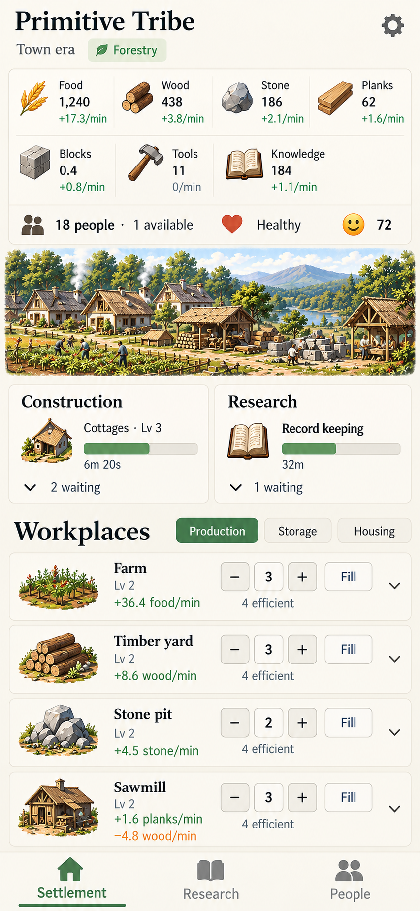

# Primitive Tribe visual guide

Primitive Tribe should feel like a living settlement recorded in a field notebook: warm, practical, and quietly rewarding to revisit. Painted illustrations give the world character; clear numbers and compact controls make its economy understandable.

This guide sets the visual direction, not a finished screen specification. [Agent guidance](../AGENTS.md) governs design decisions, and [README](../README.md) describes current gameplay. The reference illustrates a town-stage settlement; its numbers, labels, and arrangement are examples rather than gameplay requirements.

## Visual anchor

Carry forward the reference's ivory surfaces, forest-green accents, painted resources, and readable workplace rows. Its generous overview and scenery establish the mood, but the playable screen must leave room for decisions. Preserve the character as the layout adapts.

## What should stand out

A returning player should quickly see what is growing or running short, what work is underway, and where people can help. Give these questions a clear visual order:

| Priority | What the player sees |
| --- | --- |
| Economic state | Resource amounts and net change, with shortages easy to spot. |
| Immediate decisions | Available people, workplace output, and nearby assignment controls. |
| Ongoing plans | Current construction and research, their progress, and anything preventing work. |
| Settlement identity | Era, specialization, and an illustration that makes growth feel tangible. |

Readability and useful controls take precedence when space is tight. Keep routine information quiet enough that a stalled project or a meaningful discovery can stand out.

## Atmosphere and visual language

Use a warm ivory background, softly separated surfaces, dark ink, and restrained green accents. Thin borders and gentle corners should organize information without making every label a separate card. Keep texture in the artwork so numbers and controls sit on calm surfaces.

Pair sturdy serif headings with plain, highly readable labels and numbers. Quantities should be stronger than supporting rates; workplace names should be stronger than levels and efficiency notes. Use consistent alignment and spacing to make repeated rows easy to compare.

Give color a stable meaning:

| Treatment | Meaning |
| --- | --- |
| Forest green | Primary actions and selected destinations or filters. |
| Green rate text | Positive production or a growing balance. |
| Amber with a clear label | Consumption, a declining balance, or a local shortage. |
| Muted neutral | Secondary information and unavailable actions. |

A recipe consuming materials is ordinary activity. Distinguish it from a shortage through wording and state, so a working production chain does not look broken. Pair color with signs, labels, or recognizable symbols.

## A settlement with character

Resources and workplaces belong to one painted family: earthy materials, consistent lighting, and clear silhouettes. A log, a plank, and a finished building should feel related while remaining easy to distinguish. Label unfamiliar symbols.

The settlement landscape is a reward for progress and a source of atmosphere. Keep it shallow enough that the economy remains close at hand. It should read as a view of the settlement, without suggesting map placement or direct controls.

Carry the same visual language into later eras. New machinery and discoveries can change the materials and silhouettes while retaining the warmth and legibility of the early settlement. Visual growth should make progress recognizable without requiring a new interface for every era.

## Organize around decisions

Keep resource amounts and net rates together. The overview shows the settlement's overall balance; a workplace shows its own production and consumption. Make that distinction clear through grouping and labels. Reveal resources as they become relevant, and accommodate a growing economy without shrinking everything into tiny cells.

Group population, available people, and wellbeing into a compact settlement summary. Keep detailed personal information in People, with individual assignment close at hand. Navigation and persistent summaries should complement each other without repeating a full roster or the same controls in several places.

Give construction and research equal visual weight as independent plans. Their summaries should communicate the current project, progress, and status; ordered waiting plans belong in optional detail. An idle or blocked project needs a short local explanation beside its progress.

Workplace rows are the main allocation surface. Keep identity, output, inputs, and worker controls in consistent positions. Players should be able to compare workplaces and change staffing without opening every row. Expansion, equipment, and individual contributions can appear in the workplace's details.

Present efficiency and storage pressure as gradual slowdowns. A full-looking meter or staffing label must not suggest a hard limit where further investment or assignment remains useful.

## Compact screens and growing settlements

On phones, keep the economic overview within easy reach and give the workplace list enough room to be useful. When height is limited, reduce scenery and secondary plan detail before reducing text or controls. Avoid an opening screen dominated by summaries that pushes every decision below the fold.

Keep frequent controls comfortable to tap and clearly separated from detail disclosures. Long names, larger balances, and extra resources should wrap or scroll naturally. Navigation must leave the final row and its actions reachable.

Use stable destinations for major tasks and lighter filters within a view. People and project details should remain easy to reach without repeated panel switching. The reference's bottom navigation illustrates this intent; its exact arrangement is not a requirement.

On larger screens, use the extra room for related information side by side while preserving the same hierarchy. Wider layouts should make comparison easier and keep attention on the current task.

## Discovery and feedback

The opening should feel small and deliberate: a person, food, and a few meaningful actions. Introduce new information where players will later expect to find it. Let the interface gain depth as the settlement grows, without filling early screens with locked systems or instructions.

Keep routine feedback local: a button responds, progress advances, a value changes. Reserve prominent notices for discoveries, consequential choices, and problems that need attention. Animation should explain activity or add a little life, never compete with the economy.

A return from time away should make progress satisfying to inspect. Lead with a compact summary, with the useful history available on demand. Keep the player's next decisions visible nearby.

## Review standard

Judge the direction by whether a player can read the economy, understand a slowdown, move people, and inspect plans with little searching. Check both a sparse opening and a busy later settlement, especially on narrow and short screens.

The result should retain the reference's warmth while making the next meaningful decision easy to find. Artwork earns its space through atmosphere; every control and information group earns its space through play.
